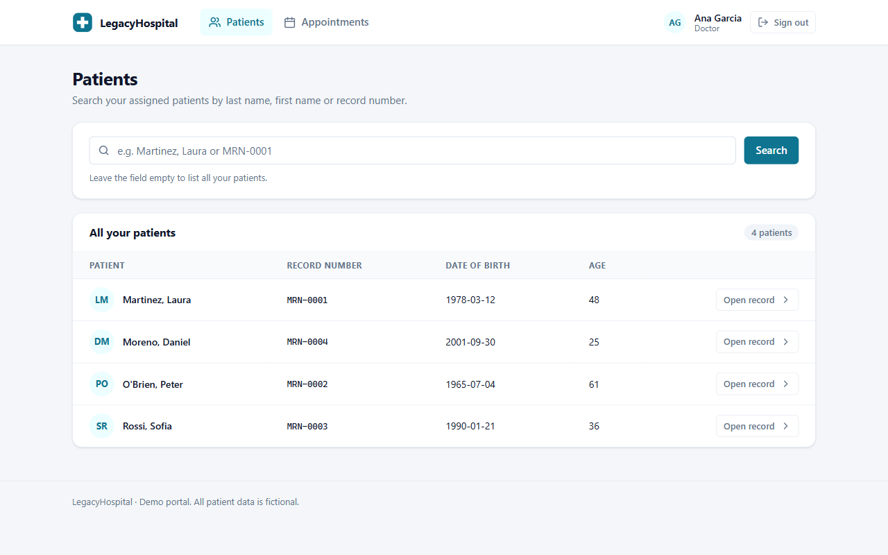
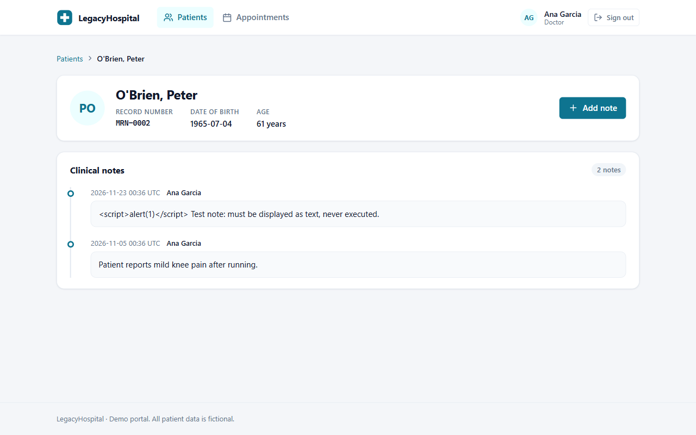
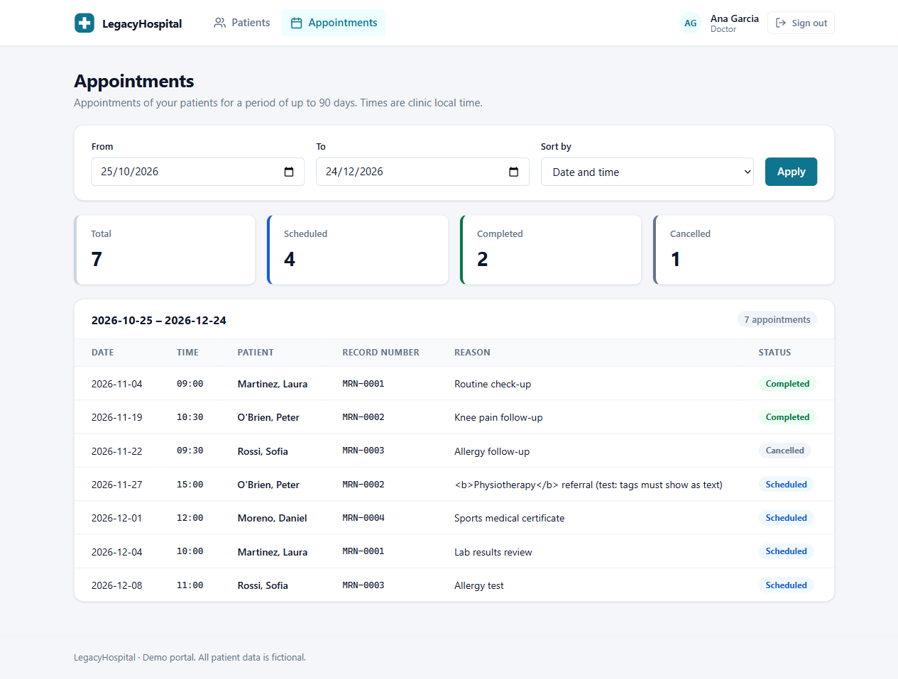
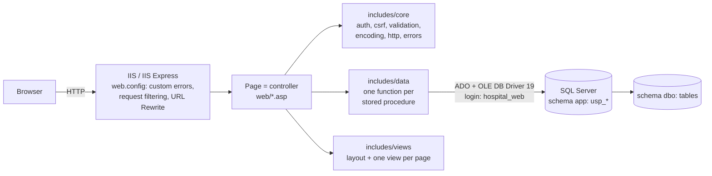

# LegacyHospital

A fictional hospital patient portal in **Classic ASP (VBScript) and SQL Server** that shows how to write and verify secure code in a legacy Microsoft stack: parameterized stored procedures, access control enforced in the database, CSRF protection, output encoding, a strict CSP, and a security review with every finding tracked to closure.

> All patient data is fictional.



| Patient record | Appointments report |
|---|---|
|  |  |

## What it does

Doctors sign in and can:

- **search** their assigned patients by last name, first name or record number,
- open a **patient record** with its clinical notes and **add notes**,
- see an **appointments report** for a period of up to 90 days, sorted by date, patient or status.

Each doctor only ever sees their own patients.

## Architecture



- **Pages are controllers** (16 to 55 lines): `RequireLogin`, validate input, call the data layer, include their view. No SQL, no long HTML.
- **`includes/data/`** is the only place that calls stored procedures, one VBScript function per procedure (`Patients_Search`, `Notes_Add`, ...).
- **`includes/views/`** only prints variables through `Html()`. Styles live in `web/assets/css/app.css`; no inline styles or scripts.
- **The database is the security boundary.** The web app connects as `hospital_web`, which can only `EXECUTE` procedures in schema `app`. Every procedure filters by the logged-in doctor, so access control does not depend on each page remembering to check it.

```
web/                 IIS site root
  *.asp              controllers (login, logout, search, patient, add_note, report, error)
  includes/          blocked for HTTP (hiddenSegments)
    app.asp          the shared include every page uses
    core/ data/ views/
  assets/            CSS, logo
db/                  T-SQL scripts, run in order 01..04
config/              connection string (.udl), outside the web root, never committed
tests/               syntax check and HTTP security tests
tools/               run-local.ps1
docs/                security review, screenshots
```

## Security controls (OWASP Top 10 2021)

| Risk | Controls |
|---|---|
| **A01 Broken Access Control** | `RequireLogin` first on every page. Procedures filter by `@UserId` taken from the session, never from the request. "Does not exist" and "not yours" return the same 404 body, so record IDs cannot be enumerated. Adding a note checks ownership and inserts in one statement. |
| **A03 Injection** | Every query is an `ADODB.Command` calling a stored procedure with typed parameters. The only dynamic SQL (`ORDER BY`) uses a whitelist in ASP and again in SQL, `QUOTENAME`, and `sp_executesql`, and runs as `app_dynamic_reader` (SELECT on two tables). Every value written to HTML goes through `Server.HTMLEncode`; attributes always use double quotes. |
| **A07 Identification and Authentication Failures** | One generic login error; the password hash is computed even for unknown users so response time does not reveal them. Limits counted in the database: 30 failures from one IP in a minute → 429 (password spraying); 5 failed passwords for one username from one IP → that pair is locked for 15 minutes (no remote lockout of a doctor); 50 consecutive failures → account locked for 15 minutes. Sessions end after 8 hours, and within 5 minutes of a user being deactivated. **Session fixation:** Classic ASP cannot regenerate the session ID, so login takes two requests with a one-time ticket and a fresh session (see `includes/core/auth.asp`). Session cookie `HttpOnly; SameSite=Lax; Secure`; app cookies `HttpOnly; SameSite=Strict; Secure`. |
| **A01 / CSRF** | Synchronizer token from `CRYPT_GEN_RANDOM` on every POST (including login and logout), compared in constant time. Logout is POST-only. |
| **A05 Security Misconfiguration** | CSP without inline script or style, `X-Frame-Options: DENY`, `nosniff`, `Referrer-Policy: no-referrer`, `Cache-Control: no-store`. `Server` and `X-Powered-By` removed. Custom error page; ASP error details never reach the browser (verified with the error page removed). Include files not reachable over HTTP. |
| **A02 Cryptographic Failures** | HTTPS only: HTTP answers a 301 to HTTPS, plus `Strict-Transport-Security`. Salted, iterated SHA2_512 password hashes (≥ 100 ms each, versioned and upgraded on next login); tokens from `CRYPT_GEN_RANDOM`, never `Rnd()`. Connection string outside the web root, in a folder only the site's identity and administrators can read. See limitations below. |
| **A09 Logging and Monitoring** | `SecurityAudit` records every sign-in attempt (with the reason, never shown to the user), CSRF failures, record views and denied record IDs, notes added, sign-outs and ended sessions, with user and IP. Technical error details go to `AppErrorLog` (falls back to the IIS log if the database is down); users see a generic message. Both logs are capped against floods and purged by age. |

Design decisions and their reasons are in the code comments where they apply (for example `core/auth.asp` for the login ticket, `db/02_procedures.sql` for the dynamic `ORDER BY`).

## Run it locally

Requirements (Windows): IIS Express, SQL Server LocalDB, `sqlcmd` and Microsoft OLE DB Driver 19 for SQL Server. Visual Studio's "ASP.NET and web development" and "Data storage and processing" workloads usually include the first three. `tools\run-local.ps1` checks all four and says which one is missing.

```powershell
# First time: creates the database, config\hospital.udl and prints the passwords once
powershell -NoProfile -ExecutionPolicy Bypass -File tools\run-local.ps1 -RebuildDatabase

# Next times
powershell -NoProfile -ExecutionPolicy Bypass -File tools\run-local.ps1
```

Open https://localhost:44300 (http://localhost:8080 redirects there; the certificate is the IIS Express development one) and sign in as `dr.garcia`, `dr.smith` or `dr.chen` with the doctors' password the script printed.

From Visual Studio: open `LegacyHospital.sln`, set `login.asp` as start page and use **Ctrl+F5** (not F5: it offers to add `debug="true"` to `web.config`).

To use SQL Server Express instead of LocalDB, run `db/01..04` with `sqlcmd` (each script explains its variables: passwords are passed as hex, and the seed requires `-v Environment=Dev`) and point `config/hospital.udl` to the server.

## Tests

```powershell
# Compile-only check of every page with its includes (no code runs)
powershell -NoProfile -ExecutionPolicy Bypass -File tests\asp-syntax-check.ps1

# 73 HTTP checks against the running site
$env:LEGACYHOSPITAL_SEED_PASSWORD = '<doctors password>'
powershell -NoProfile -ExecutionPolicy Bypass -File tests\e2e-security.ps1
```

The HTTP checks act like a browser and cover the HTTPS redirect and HSTS, login and lockout messages, the per-IP rate limit and the per-IP + username lockout, CSRF, session ID change on login, search by POST only, SQL injection and XSS payloads in search, IDOR on records and notes (including that no row is inserted), audit rows, ID and date validation, the sort whitelist, stored XSS in notes, logout, security headers, cookie attributes and files outside the site root. The last checks trigger the rate limit: sign-ins from the machine get 429 for about a minute.

## Security review

[`docs/security-review.md`](docs/security-review.md) lists 22 findings from a manual review, each with CWE, severity, vulnerable path and acceptance criteria, plus a verification log of how each closed one was tested.

**Status:** all 22 closed; four with a documented residual risk (F-05, F-08, F-13, F-14).

## Known limitations

- **Password hashing** is iterated SHA2_512 (≥ 100 ms per hash), because neither SQL Server nor VBScript offers bcrypt or Argon2. It is still weaker than those against GPU cracking (F-05).
- **The `.udl` holds the `hospital_web` password** locally: IIS Express runs as the developer, so Windows authentication would not give a least-privilege identity. On full IIS, use the app pool identity instead (F-08).
- **Rate limits use `REMOTE_ADDR`**. Behind a reverse proxy, IIS must see the real client address, or every user shares one IP and one limit.
- Each anonymous request creates an in-memory ASP session; a request rate limit belongs in front of IIS (F-14).
- The HTTP tests are PowerShell for now; they are meant to move to xUnit.

## How it was built

The code was written with an AI coding assistant (Claude Code), working under explicit rules rather than free-form prompts:

- **[`CLAUDE.md`](CLAUDE.md)** sets the mandatory security rules (parameterized procedures only, encoding, CSRF, no IDOR, least-privilege login, no technical errors for users) and the way of working: a short plan before any code, one part at a time, and never weakening a rule to make something work.
- **Design decisions were made by the author**: where the connection string lives, the `error.asp` exception to the login rule, adding appointments to the schema, the layered refactor. The assistant proposed options with their trade-offs and implemented the chosen one.
- **Nothing was taken on trust; every step was verified.** A hook compiles every page after each edit, procedures were tested directly as `hospital_web`, the HTTP security tests were run before and after each change, and pages were checked in a real browser.
- **Verification found real bugs** that reading the code had missed, all documented in the security review: the session ID did not change on login (ASP hides its own cookie from `Request.Cookies`), a duplicated `ORDER BY` column broke the default report, IIS Express in `/path` mode silently discarded the "hide error details" setting, and Visual Studio had added `debug="true"` to `web.config`.
- Repeatable tasks are captured as project skills in [`.claude/skills`](.claude/skills): `run-local`, `new-page` and `asp-review`.

## Tech stack

Classic ASP (VBScript) on IIS / IIS Express · SQL Server (LocalDB for development) · ADO with Microsoft OLE DB Driver 19 · URL Rewrite · PowerShell for tooling and tests.

## License

[MIT](LICENSE). The data is fictional; the code is a portfolio project, not a production medical system.
